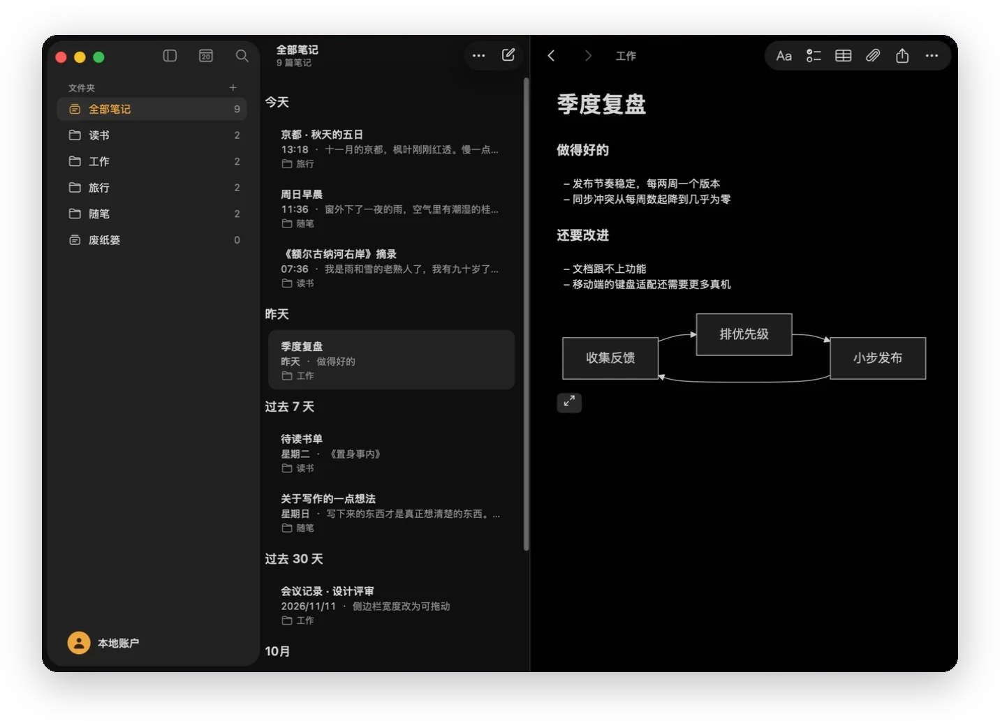
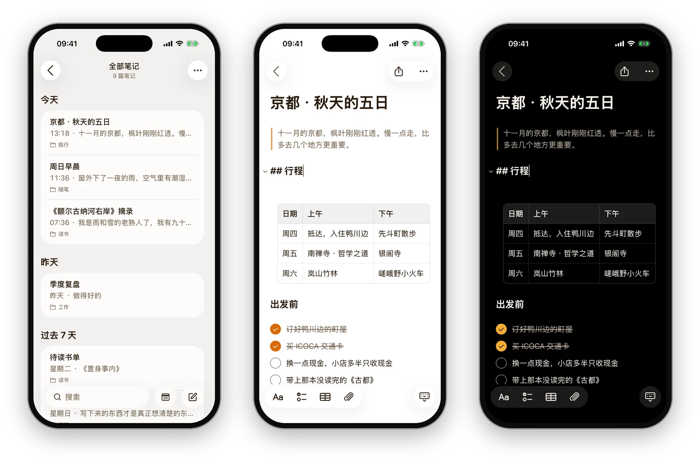

<div align="center">
  
  <h1>轻羽 QingYu</h1>
  <p><b>给文字，一处安静的地方。</b></p>
  <p>一款本地优先的 Markdown 笔记应用。打开一个文件夹就能开始写，每篇笔记都是普通的 .md 文件，换个编辑器也能接着改。</p>
  <p>
    <a href="https://github.com/appdev/QingYu/releases/latest"></a>
    
    <a href="LICENSE"></a>
  </p>
  <p>
    <a href="https://github.com/appdev/QingYu/releases/latest"><b>下载轻羽</b></a> · <a href="#自托管-web-版">自托管 Web 版</a> · <a href="#本地开发">从源码构建</a>
  </p>
  <p>
    <b>简体中文</b> · <a href="docs/readme/README.zh-TW.md">繁體中文</a> · <a href="docs/readme/README.en.md">English</a> · <a href="docs/readme/README.ja.md">日本語</a> · <a href="docs/readme/README.ko.md">한국어</a> · <a href="docs/readme/README.fr.md">Français</a> · <a href="docs/readme/README.de.md">Deutsch</a> · <a href="docs/readme/README.es.md">Español</a> · <a href="docs/readme/README.pt-BR.md">Português do Brasil</a> · <a href="docs/readme/README.it.md">Italiano</a> · <a href="docs/readme/README.ru.md">Русский</a>
  </p>
</div>

<p align="center">
  
</p>

## 特点

- **文件就是笔记**：笔记库就是一个文件夹，正文都是标准 Markdown。备份、迁移、用 Git 管理都随你。
- **所见即所得**：标题、表格、待办直接编辑，输入 `/` 插入内容。公式、Mermaid 流程图和 Markmap 思维导图在正文里直接显示。
- **全平台**：macOS、Windows、Linux、Android、iOS 都有原生应用，也可以部署成网页版。
- **本地优先，同步可选**：本地写作不需要账号。需要跨设备时，可以用轻羽云或自己的 S3 兼容存储，原生应用会在上传前加密。

## 写作与整理

- 侧栏按文件夹整理笔记，全文搜索能找回正文里的一句话。
- 今日笔记适合记日程；版本历史可以找回删掉的段落。
- 分享时可以把整篇笔记或选中的一段排成图片，复制、保存或直接发出去。
- Mac 菜单栏里可以随手记一条。想让 AI 工具读写笔记库，在设置里开启 MCP 服务即可。



## 手机上

手机版和桌面版用同一套编辑器。键盘上方的工具栏可以插入附件、调整格式，深浅色跟随系统。



## 外观与语言

- 外观可选浅色、深色或跟随系统，另有默认、纸张、暖棕、岩灰、森林、高对比度六套主题。
- 正文字体和字号可以单独调整。
- 界面支持 11 种语言，在「设置 → 通用 → 语言」切换，也可以跟随系统。


## 同步

两台设备改到同一处时，轻羽会保留冲突副本，不会直接覆盖。原生应用在上传前加密笔记和附件。

> [!WARNING]
> 请保管好同步密码。如果忘记密码，又失去了所有已解锁的设备，云端数据将无法解密。

详见[同步说明](docs/s3-sync.md)。

## 安装

| 平台 | 安装包 |
| --- | --- |
| macOS · Apple Silicon / Intel | `aarch64.dmg` / `x64.dmg` |
| Windows · x64 | `x64-setup.exe` |
| Linux · x64 | `.deb` / `.AppImage`（需要 WebKitGTK 4.1） |
| Android · arm64 | `.apk` |
| iOS | 暂无安装包，需[从源码构建](docs/development.md) |
| Web | Docker 镜像 · Linux amd64 / arm64 |

- **macOS**：安装包未经 Apple 公证，首次打开时可能被拦截，到「系统设置 → 隐私与安全性」里点「仍要打开」。
- **Windows**：安装包未签名，可能出现 SmartScreen 提示，点「更多信息 → 仍要运行」。

## 自托管 Web 版

网页版直接读写服务器上挂载的笔记目录，只用一个访问密码登录，不需要账号。用仓库里的 `compose.yaml` 启动：

```sh
export QINGYU_WEB_PASSWORD='至少 12 个字符的密码'
export QINGYU_DATA_DIR=/absolute/path/to/notes
docker compose up -d
```

服务默认只监听 `127.0.0.1:8787`，Cookie 带 `Secure`，请放在 HTTPS 反向代理后面使用。本机 HTTP 调试、API Token 和更多配置见 [Web 部署指南](docs/api-service.md)。

## 本地开发

需要 Node.js 22、Rust 1.96.0（`rust-toolchain.toml` 已固定）和 [Tauri 2 的系统依赖](https://v2.tauri.app/start/prerequisites/)。在仓库根目录运行：

```sh
npm ci
npm run tauri dev   # 原生桌面窗口
```

```sh
npm run dev         # 只在浏览器里调试，http://localhost:1420
```

```sh
npm test
```

Android、iOS、Linux 打包和发布流程见[开发与发布说明](docs/development.md)。

## 许可证

轻羽以 [GPL-3.0](LICENSE) 发布。第三方组件保留各自的许可证：[MiaoYan](public/miaoyan/LICENSE) · [Markra](src/vendor/markra/LICENSE) · [MDSync](src/vendor/mdsync/LICENSE)。
