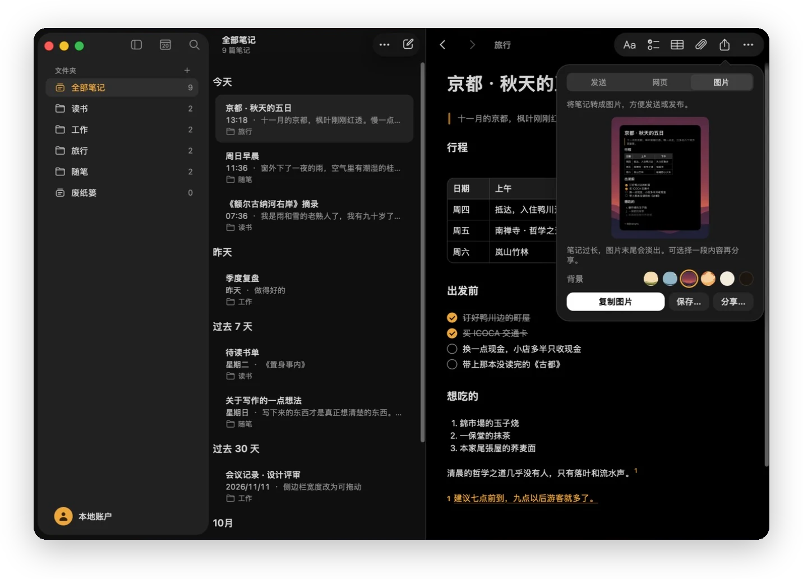
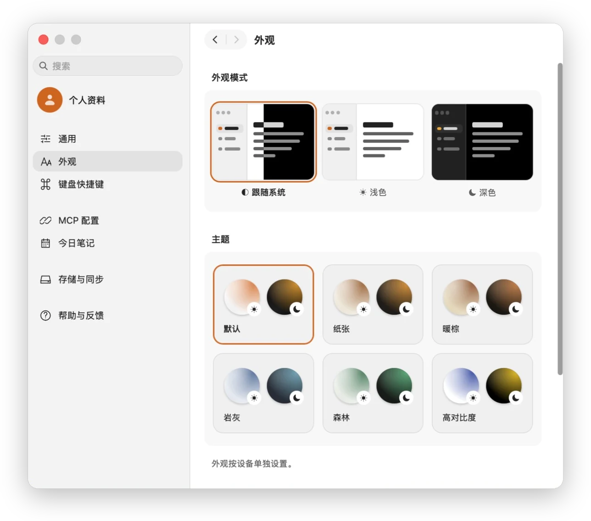

<div align="center">
  
  <h1>轻羽 QingYu</h1>
  <p><b>给文字，一处安静的地方。</b></p>
  <p>一款本地优先的 Markdown 笔记应用，写起来像备忘录，存下来是普通的 .md 文件。</p>
  <p>
    <a href="https://github.com/appdev/QingYu/releases/latest"></a>
    
    <a href="LICENSE"></a>
  </p>
</div>

<p align="center">
  
</p>

很多笔记应用要么好看但把内容锁在自己的数据库里，要么开放但写起来像在改代码。轻羽想两头都要：打开就能写，不用记语法；关掉之后，每一篇都还是你硬盘上的一个 Markdown 文件，换什么工具都能接着用。

- **写的时候看不见符号。** 标题、表格、待办、公式和流程图直接显示成排好版的样子，光标移到哪一行，那一行的 Markdown 才露出来。
- **笔记就是文件。** 文件夹对应磁盘目录，笔记是 `.md` 文件。用 VS Code、Obsidian 或 Git 改过的内容，轻羽会自动读回来。
- **熟悉的三栏布局。** 文件夹、按「今天 / 昨天 / 过去 7 天」分组的笔记列表、正文，用过系统备忘录就会用。
- **同步先加密。** 用轻羽云或你自己的 S3，笔记在本机用同步密码加密后再上传，冲突时两边都保留。
- **哪台设备都能写。** macOS、Windows、Linux、Android，也能用 Docker 部署一个网页版。

## 下载

从 [GitHub Releases](https://github.com/appdev/QingYu/releases/latest) 下载对应平台的安装包：

| 平台 | 安装包 |
| --- | --- |
| macOS（Apple 芯片） | 文件名含 `aarch64` 的 `.dmg` |
| macOS（Intel） | 文件名含 `x64` 的 `.dmg` |
| Windows | 文件名含 `x64` 的 `-setup.exe` |
| Linux | `.deb` 或 `.AppImage`，需要 WebKitGTK 4.1 |
| Android | `arm64` 的 `.apk` |
| 自托管 Web | Linux amd64 或 arm64 的 Docker 镜像 `.tar.gz`，见[导入方式](docs/api-service.md#docker-与远程访问) |

> [!NOTE]
> macOS 版暂未做 Apple 公证，第一次打开如果被拦截，请到「系统设置 → 隐私与安全性」里点「仍要打开」。Windows 安装包没有代码签名，可能会看到 SmartScreen 提示。

## 在 iPhone 上

手机版不是把桌面版缩小，而是按手机的习惯重新排了一遍：大标题、圆角分组、底部的搜索栏和新建按钮都在拇指够得到的地方。

<p align="center">
  
</p>

- 编辑时底部浮出格式栏：文字样式、待办、表格、附件，一点就插入。
- 浅色和深色跟随系统切换，深色是纯黑底，夜里看不刺眼。
- iPhone 和 Android 用同一套界面。iOS 版目前需要[从源码构建](docs/development.md)。

## 写作体验

<p align="center">
  
</p>

- **该有的格式都有。** 表格可以直接点进单元格编辑，待办点一下就勾上，还支持脚注、数学公式、提示块，以及 Mermaid、Markmap 流程图和思维导图。
- **斜杠菜单。** 输入 `/` 选择要插入的内容，不用记语法。
- **长文好管理。** 标题可以折叠，`⌘K` 跳转到任意笔记，全文搜索会搜到正文。
- **今日笔记。** 点侧栏的日历图标，打开或创建当天那一篇，适合写日记和每日待办。
- **版本历史。** 每次修改都留有旧版本，可以逐条对比，找回误删的段落。
- **废纸篓。** 删掉的笔记连同原来所在的文件夹一起保留，随时能恢复。

## 分享成一张图片

想把一篇笔记发到聊天或社交平台，可以直接转成图片：选一张背景（山丘、海边、暮色、果园，或纯色），预览后复制或保存。笔记太长时可以先选中一段，只分享这一段。

<p align="center">
  
</p>

也可以把笔记当前的内容通过系统分享发出去，或复制为纯文本。

## 换一种心情

外观可以跟随系统，也可以固定浅色或深色。另有默认、纸张、暖棕、岩灰、森林和高对比度六套主题，每套都配好了浅色和深色。正文字体和字号也能单独调整。

<p align="center">
  
</p>

## 更多细节

- **菜单栏速记（macOS）。** 关掉主窗口后，从菜单栏就能新建或查找笔记，回车保存。
- **全局快捷键。** 默认 `⌥⌘M`（Windows / Linux 为 `Ctrl+Alt+M`）在任何地方唤起轻羽，可以自己改。
- **给 AI 用的 MCP 服务。** 在设置里打开后，Claude、Cursor 等 AI 工具可以读写你的笔记库。
- **11 种界面语言。** 简体中文、繁体中文、English、日本語、한국어、Français、Deutsch、Español、Português、Italiano、Русский。
- **从妙言搬过来。** 妙言的笔记文件夹可以在「文件 → 更改笔记库位置」里直接打开，接着写。

## 同步与隐私

轻羽不需要账号也能完整使用，笔记默认只存在你选的本地文件夹里。需要多设备时，有两种方式：

- **轻羽云：** 登录后开启，打开应用、保存笔记和每 3 分钟会自动同步一次。
- **自定义 S3：** 填入你自己的 S3 兼容存储（AWS、Cloudflare R2、MinIO 等）。

两种方式都要设置一个同步密码。笔记、图片和附件在本机用这个密码加密（AES-256-GCM）后才上传，云端只看到密文。两台设备改了同一处，会保留一份冲突副本，不会互相覆盖。忘记密码又没有已解锁的设备时，云端数据将无法解开，请妥善保管。

也可以只把笔记目录放进 iCloud Drive、坚果云或 Dropbox，交给网盘同步。

详细说明见 [同步说明](docs/s3-sync.md)。

## 部署网页版

用 Docker 在自己的服务器上跑一个网页版，设置访问密码即可登录，读写的是服务器上挂载的笔记目录，可以和桌面端通过同步共用一个笔记库。部署方式见 [API 服务与 Web 部署](docs/api-service.md)。

## 从源码构建

```bash
npm install
npm run tauri dev
```

需要 Node.js、Rust 1.96 和 [Tauri 2 的系统依赖](https://v2.tauri.app/start/prerequisites/)。Android、iOS 打包、发布流程和测试说明见 [开发与发布说明](docs/development.md)。

## 致谢

轻羽从 [妙言 MiaoYan](https://github.com/tw93/MiaoYan) 出发，沿用了它的预览样式、图表资源和对排版的讲究；所见即所得编辑核心来自 [Markra](https://github.com/markrahq/markra)，同步核心来自 MDSync。界面交互参考了 [Pinto Notes](https://github.com/pinto-notes/pinto-notes)。感谢这些项目的作者。

## 许可证

[GPL-3.0](LICENSE)。随附的第三方代码保留各自的许可证，见 `public/miaoyan/LICENSE` 和 `src/vendor/markra/LICENSE`。
