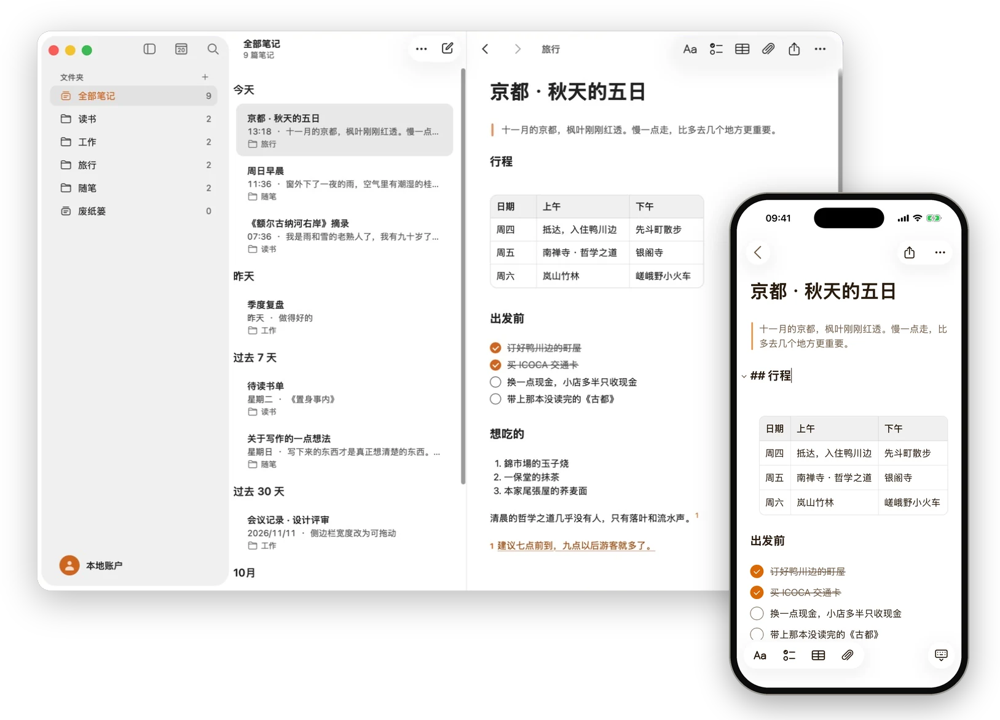

# QingYu

[简体中文](../../README.md) · [繁體中文](README.zh-TW.md) · [English](README.en.md) · [日本語](README.ja.md) · [한국어](README.ko.md) · [Français](README.fr.md) · [Deutsch](README.de.md) · [Español](README.es.md) · [Português do Brasil](README.pt-BR.md) · **Italiano** · [Русский](README.ru.md)

QingYu è un’app indipendente per prendere appunti in Markdown e conservarli sul proprio dispositivo. Apri una cartella e inizia a scrivere. Ogni nota è un normale file `.md` che puoi modificare con qualsiasi editor di testo.

[Scarica QingYu](https://github.com/appdev/QingYu/releases/latest)



## Scrivere e organizzare le note

- Modifica direttamente titoli, tabelle ed elenchi di attività, oppure digita `/` per inserire un blocco. Formule, diagrammi di flusso Mermaid e mappe mentali Markmap appaiono nel testo.
- Organizza le note in cartelle e usa la ricerca nel testo per ritrovare una frase. Annota i programmi nella nota del giorno o recupera un paragrafo cancellato dalla cronologia delle versioni.
- Sul telefono, la barra sopra la tastiera permette di formattare il testo e allegare file. Puoi copiare o salvare come immagine la nota intera o un passaggio selezionato.
- In Impostazioni → Generali → Lingua puoi scegliere fra 11 lingue per l’interfaccia o usare quella di sistema. Puoi anche cambiare il tema, il carattere e la dimensione del testo.
- Su Mac puoi prendere una nota rapida dalla barra dei menu. Per consentire a uno strumento di IA di leggere e modificare le note, attiva il servizio MCP nelle impostazioni.

## Archiviazione e sincronizzazione

Puoi scrivere sul dispositivo senza un account. Per sincronizzare più dispositivi, collega QingYu Cloud o uno spazio di archiviazione compatibile con S3. L’app nativa cifra le note e gli allegati prima di caricarli. Se due dispositivi modificano lo stesso passaggio, conserva una copia in caso di conflitto.

Conserva la password di sincronizzazione. Se la dimentichi e perdi l’accesso a tutti i dispositivi sbloccati, non potrai più decifrare i dati nel cloud. [Guida alla sincronizzazione (in cinese)](../../docs/s3-sync.md)

## Installazione e hosting sul proprio server

| Piattaforma | Pacchetto |
| --- | --- |
| macOS · Apple Silicon / Intel | `aarch64.dmg` / `x64.dmg` |
| Windows · x64 | `x64-setup.exe` |
| Linux · x64 | `.deb` / `.AppImage` · WebKitGTK 4.1 |
| Android · arm64 | `.apk` |
| iOS | [Compila dal codice sorgente](../../docs/development.md) |
| Web su server proprio | Docker · Linux amd64 / arm64 |

L’app per macOS non è autenticata da Apple. Al primo avvio potrebbe essere necessario autorizzarla in Impostazioni di Sistema → Privacy e sicurezza. Il programma di installazione per Windows non è firmato e può attivare un avviso di SmartScreen.

L’editor web legge e scrive le note in una cartella montata sul server. Imposta una password di accesso durante la distribuzione. [Guida alla distribuzione web (in cinese)](../../docs/api-service.md)

## Sviluppo locale

Installa Node.js, Rust 1.96.0 e le dipendenze di sistema di Tauri 2, quindi esegui questi comandi dalla radice del repository.

```sh
npm ci
npm run tauri dev
```

[Prerequisiti di Tauri](https://v2.tauri.app/start/prerequisites/) · [Guida allo sviluppo e alla pubblicazione (in cinese)](../../docs/development.md)

## Licenza

[GPL-3.0](../../LICENSE) · I componenti di terze parti inclusi mantengono le rispettive licenze. [MiaoYan](../../public/miaoyan/LICENSE) · [Markra](../../src/vendor/markra/LICENSE) · [MDSync](../../src/vendor/mdsync/LICENSE)
