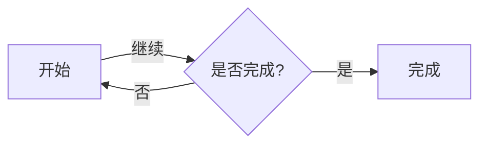
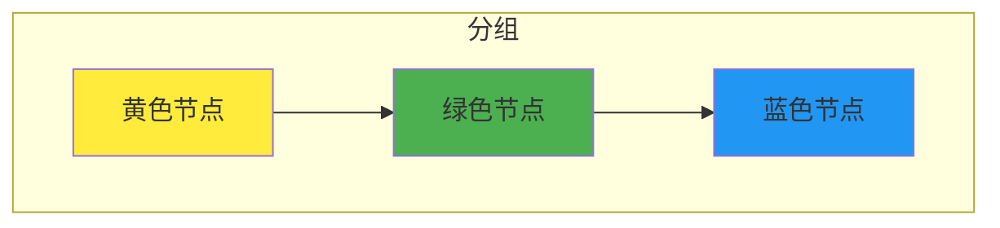
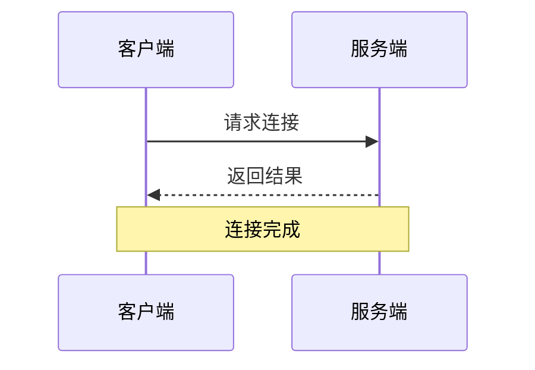
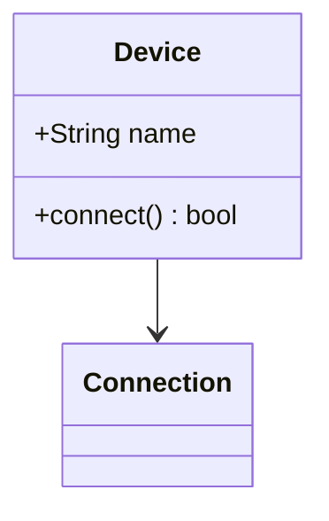
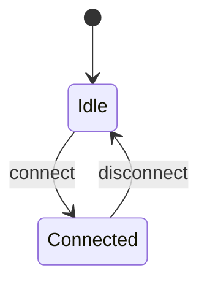
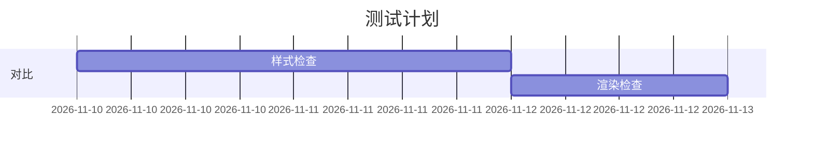
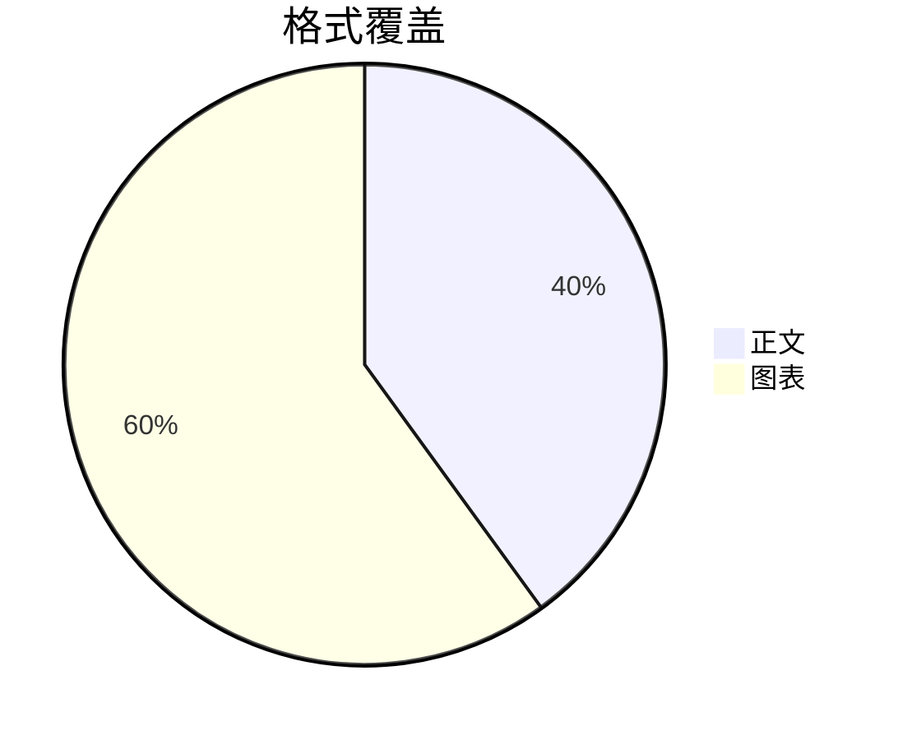
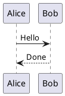

# Markdown 全格式对照

## C01 标题层级

# 一级标题 Heading 1

## 二级标题 Heading 2

### 三级标题 Heading 3

#### 四级标题 Heading 4

##### 五级标题 Heading 5

###### 六级标题 Heading 6

## C02 正文与自动换行

普通正文，中文与 English 123 混排。用于检查字体、字号、行高、段间距与自动换行。普通正文，中文与 English 123 混排。用于检查字体、字号、行高、段间距与自动换行。普通正文，中文与 English 123 混排。

第二段正文：标点（括号）、引号“内容”、破折号——以及 emoji 🌱。

## C03 强调与行内样式

**中文加粗**、**English bold**、*中文强调*、*English emphasis*、***中文加粗强调***、***English bold italic***、~~删除线~~、`inlineCode()`、`a < b && b > 0`。

嵌套 **加粗中的 *强调* 和 `代码`**，链接里的 [**加粗文字**](https://example.com)。

## C04 换行与转义

软换行第一行
软换行第二行。

硬换行第一行（行尾两个空格）  
硬换行第二行。

反斜线换行第一行\
反斜线换行第二行。

转义 \*星号\*、\#井号、\[方括号\]、&amp;、&lt;tag&gt;、非断行空格 A&nbsp;B。

## C05 链接与引用链接

[普通链接](https://example.com "标题")、[引用链接][example]、<https://example.com>、<test@example.com>、裸链接 https://example.com/path?q=1。

[example]: https://example.com "引用标题"

## C06 分隔线

上方正文。

---

下方正文。

***

第二条分隔线之后。

## C07 无序与嵌套列表

- 第一项 **加粗**
- 第二项
  - 二层列表
    - 三层列表
  - 二层结束
- 第三项

## C08 有序列表与起始序号

3. 从三开始
4. 第二项
   1. 嵌套有序项
   2. 嵌套第二项
5. 最后一项

## C09 宽松列表与混合块

- 第一项第一段。

  第一项第二段，包含 `inline()`。

- 第二项。

  > 列表中的引用。

  ```js
  const item = 2;
  ```

## C10 任务列表

- [x] 已完成任务
- [ ] 未完成任务
  - [x] 嵌套完成
  - [ ] 嵌套待办

## C11 普通与嵌套引用

> 第一段引用 **中文加粗**、*English emphasis*、`quoteCode`。
>
> 第二段引用。
>
> > 嵌套引用。
>
> - 引用中的第一项
> - 引用中的第二项

## C12 五种提示块

> [!NOTE]
> 注意信息，包含 **加粗** 和 [链接](https://example.com)。

> [!TIP]
> 建议信息。

> [!IMPORTANT]
> 重要信息。

> [!WARNING]
> 警告信息。

> [!CAUTION]
> 谨慎信息。

## C13 表格与列对齐

| 左对齐 | 居中 | 右对齐 |
| :--- | :---: | ---: |
| 表格文本 | **加粗** | 123 |
| *English* | `tableCode` | 4567 |
| 转义竖线 \| | [链接](https://example.com) | 89 |

## C14 长表格与单元格换行

| 描述 | 值 |
| --- | --- |
| 很长的中文单元格用于检查自动换行和表格宽度，很长的中文单元格用于检查自动换行和表格宽度，很长的中文单元格用于检查自动换行和表格宽度。 | 中文内容 |
| 第一行<br>第二行 | veryLongIdentifierWithoutSpaces_abcdefghijklmnopqrstuvwxyz0123456789 |

## C15 Swift 代码高亮

```swift
// 中文注释
let greeting = "你好，妙言"
print(greeting)
let count = 42
```

## C16 Kotlin Java JS JSON 高亮

```kotlin
data class User(val name: String, val count: Int = 42)
```

```java
public class Demo { String value = "hello"; }
```

```javascript
const values = [1, 2, 3].map(x => x * 2);
```

```json
{"name":"妙言","enabled":true,"count":42}
```

## C17 无语言与未知语言代码

```
root()
├── 中文节点
└── child() <literal> & text
```

```unknown-language
<literal> & text
```

## C18 缩进代码与长代码行

    indentedCode()
    secondLine()

```text
这一行非常长 abcdefghijklmnopqrstuvwxyz0123456789 abcdefghijklmnopqrstuvwxyz0123456789 abcdefghijklmnopqrstuvwxyz0123456789 abcdefghijklmnopqrstuvwxyz0123456789 end
```

## C19 行内数学公式

行内公式 $E = mc^2$，分式 $\frac{a+b}{c}$，中文后接 $x_1 + x_2$。

## C20 块级公式与矩阵

$$
\begin{aligned}
f(x) &= x^2 + 2x + 1 \\
     &= (x+1)^2
\end{aligned}
$$

$$
\begin{pmatrix}1 & 2 \\ 3 & 4\end{pmatrix}
$$

## C21 Mermaid 流程图



## C22 Mermaid 自定义配色



## C23 Mermaid 时序图



## C24 Mermaid 类图与状态图





## C25 Mermaid 甘特图与饼图





## C26 Mermaid 错误回退

```mermaid
flowchart LR
 A[未闭合
```

## C27 脚注与重复引用

第一条脚注[^one]，再次引用[^one]，第二条脚注[^two]。

[^one]: 脚注第一段，包含 **加粗**、`code` 和 [链接](https://example.com)。

    脚注第二段。

[^two]: 第二条脚注。

## C28 图片


## C29 HTML 行内扩展

<mark>高亮文字</mark>、H<sub>2</sub>O、x<sup>2</sup>、<u>下划线</u>、<kbd>⌘</kbd> + <kbd>K</kbd>。

## C30 HTML 折叠块

<details open>
<summary>展开详情</summary>
<p>折叠块正文 <strong>HTML 加粗</strong>。</p>
</details>

## C31 非标准 Markdown 扩展

==高亮语法==、~下标~、^上标^、:smile:。

术语
: 定义列表内容

## C32 目录与内部锚点

[TOC]

[跳到代码](#c15-swift-代码高亮)

## C33 结束检查

文档结束。此段用于检查末尾间距和脚注位置。

## C34 普通 PNG 图片


## C35 Markmap 思维导图

```markmap
# 格式测试
## 正文
- 标题
- 列表
## 图表
- Mermaid
```

## C36 PlantUML 时序图



## C37 Setext 标题

等号一级标题
============

短横线二级标题
--------------

末尾普通正文。
